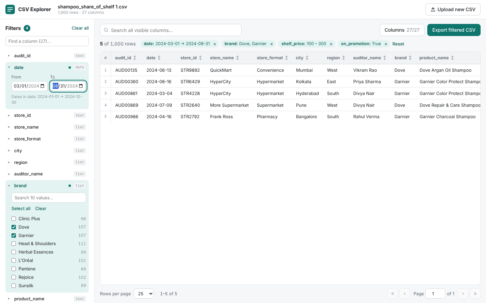

# CSV Explorer

A React page for uploading a CSV file, viewing it as a table, and filtering it by any column.
Built with React 18, Vite and PapaParse. Everything runs in the browser, so no data is uploaded anywhere.



## Quick start

Requires Node.js 18 or newer.

```bash
npm install
npm run dev        # open http://localhost:5173
```

Production build:

```bash
npm run build      # outputs to dist/
npm run preview    # serve the built app locally
```

## Features

- **Upload**: drag and drop or click to browse. The first row is used as headers. A bundled sample
  (`public/sample.csv`, the shampoo share-of-shelf audit) can be loaded from the start screen.
- **Table**: sticky header, row numbers, click a header to sort (asc → desc → off), pagination
  with 10/25/50/100 rows per page. Blank cells show as "—", and True/False values are shown as badges.
- **Per-column filters**: each column's type is detected automatically and gets a matching control.

  | Detected type | When | Filter control |
  |---|---|---|
  | `yes/no` | only true/false/yes/no values | All / True / False toggle with counts |
  | `date`   | ISO dates (`YYYY-MM-DD`) | From / To date range |
  | `list`   | ≤ 40 distinct values, or numbers with ≤ 12 distinct values | Multi-select checklist with counts and search |
  | `number` | numeric with more distinct values | Min / Max range |
  | `text`   | everything else | "Contains" (case-insensitive) |

- **Global search** across all visible columns.
- **Active filter chips** above the table. Remove one with ×, or click **Reset** to clear everything.
- **Show/hide columns** from the **Columns** menu.
- **Export** the filtered and sorted rows (visible columns only) as a new CSV.
- Responsive layout. On narrow screens the filter panel becomes a slide-over drawer. Supports dark mode.

## Project structure

```
src/
  App.jsx                    state, derived data (filter → sort → paginate), layout
  main.jsx                   entry point
  index.css                  all styles (light + dark themes)
  utils/csv.js               parsing, type detection, filter predicates, sorting, export
  components/
    FileUpload.jsx           drop zone + compact "upload new" button
    FilterPanel.jsx          sidebar listing every column's filter
    ColumnFilter.jsx         per-type filter controls (list, range, date, boolean, text)
    DataTable.jsx            sortable table
    Pagination.jsx           page navigation and page size
    ColumnPicker.jsx         show/hide columns
public/sample.csv            sample dataset
```

## Customising

- Change the type-detection thresholds with `CATEGORY_LIMIT` and `NUMERIC_CATEGORY_LIMIT` in `src/utils/csv.js`.
- Change the accent colour with `--accent` in `src/index.css`.
